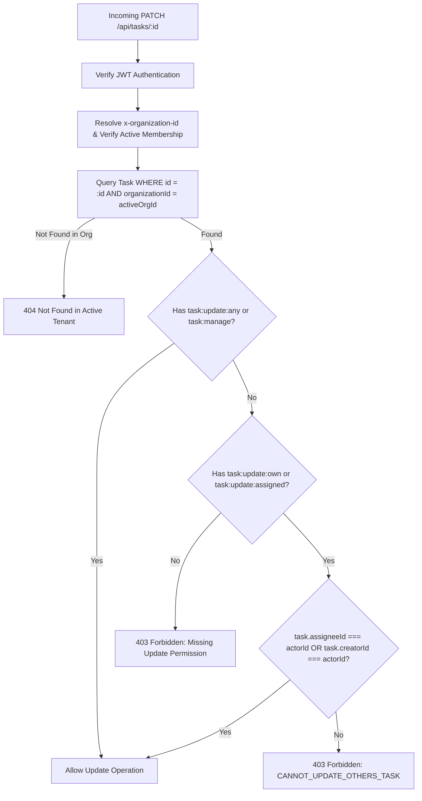
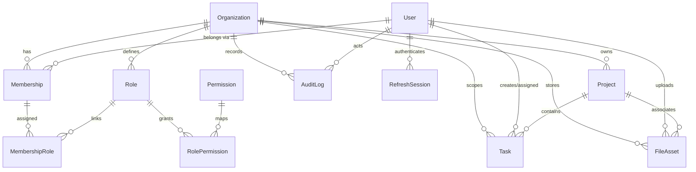

# TeamGuard Product Specification — Multi-Tenant Work Management & Authorization Platform

---

## Section 1 — Document Control

| Metadata Field | Value |
| :--- | :--- |
| **Document Title** | TeamGuard Canonical Product Specification |
| **Document Identifier** | `TG-SPEC-v1.1.0-draft` |
| **Target Path** | [.agents/rules/teamguard-product-specs.md](file:///c:/Users/Abhijeet%20Rawat/Desktop/rbac/.agents/rules/teamguard-product-specs.md) |
| **Document Version** | `1.1.0-draft` |
| **Document Status** | Draft — Pending Product Review |
| **Last Updated** | 2026-10-14 |
| **Primary Domain** | Multi-Tenant Work Management, Project Execution, Granular RBAC/ABAC Governance |
| **Author / Custodian** | TeamGuard Core Product & Architecture Engineering |

> [!IMPORTANT]
> **Approval Notice**: This document is a comprehensive working specification undergoing formal stakeholder review. It consolidates verified repository capabilities, required corrections, and pending architectural proposals. It must **not** be treated as an approved canonical baseline until all pending decisions (UD-001 through UD-005) and policy choices are formally ratified by product stakeholders.

### 1.1 Source-of-Truth Policy
This document serves as the authoritative product, functional, and access-control specification for **TeamGuard**. All downstream engineering design documents, user stories, API contracts, acceptance criteria, and database migration proposals must directly trace back to the definitions, business rules, invariants, and feature identifiers established herein. No feature, interaction model, or authorization bypass may be introduced into the application without updating this specification.

### 1.2 Relationship to Downstream Artifacts
- **User-Story Catalogues**: Future user stories (e.g. `US-TASK-001`) must reference the stable Feature Identifiers defined in [Section 17](#section-17--acceptance-principles-and-traceability).
- **Engineering Roadmaps & Sprints**: Sprint backlogs must prioritize items according to the implementation statuses documented in [Section 5](#section-5--product-status-and-evidence-conventions) and [Section 16](#section-16--product-boundaries-and-unresolved-decisions).
- **Architecture & Security Rules**: This specification operationalizes the principles codified in [.agents/rules/teamguard-rbac.md](file:///c:/Users/Abhijeet%20Rawat/Desktop/rbac/.agents/rules/teamguard-rbac.md).

---

## Section 2 — Product Vision and Positioning

### 2.1 Product Vision
**TeamGuard** is an all-in-one, multi-tenant SaaS work-management and team execution platform engineered for teams that demand rigorous security, enterprise-grade access governance, and modern productivity workflows. It unifies project tracking, task execution, document asset management, and organization administration into a cohesive, high-performance workspace.

### 2.2 Problem Statement
Modern organizations frequently struggle with two conflicting extremes in work-management tooling:
1. **Permissive Collaboration Tools** (e.g., legacy wikis, generic kanban boards) offer flexible UX but lack tenant-isolated security boundaries, granular permission control, resource-level ownership constraints (ABAC), and verifiable audit logging.
2. **Heavyweight Enterprise Suites** (e.g., traditional ERPs, rigid compliance trackers) enforce security at the expense of developer velocity, keyboard ergonomics, modern aesthetics, and intuitive task visualization.

TeamGuard resolves this tension by delivering a high-velocity, keyboard-accessible work platform backed by a server-authoritative, fail-closed authorization engine.

### 2.3 Target Customers & Users
- **Target Customers**: Small-to-medium businesses (SMBs), fast-growing technology startups, digital agencies managing client-segregated projects, and compliance-conscious engineering organizations.
- **Target User Personas**:
  - *Platform Operators / Site Reliability Engineers*: Require system-wide health observation, tenant provisioning, and global compliance oversight without uncontrolled access to tenant customer data.
  - *Organization Owners & Executive Leaders*: Require macro visibility, capacity metrics, sprint progress, administrative control, and billing/governance sovereignty.
  - *Project & Delivery Managers*: Require Kanban board controls, task assignment, milestone tracking, and project-scoped asset management.
  - *Individual Contributors (Engineers, Designers)*: Require fast task detail inspection, checklists, discussion feeds, and distraction-free task transitions.
  - *External Stakeholders & Clients*: Require transparent, strictly scoped, read-only visibility into deliverables without risks of cross-tenant data exposure.

### 2.4 Competitive Inspiration Matrix
TeamGuard synthesizes proven paradigms from industry-leading tools:

| Benchmark Product | Adopted Design & Functional Paradigms |
| :--- | :--- |
| **ClickUp** | Multi-view task representation (Board, List, Table), hierarchical project-to-task relationships, customizable task statuses, and KPI dashboard widgets. |
| **Notion** | Information architecture, clean typography, modular file and metadata management, and distraction-free workspaces. |
| **Jira** | Structured issue lifecycles, project keys, permission matrices, multi-tenant governance, and strict workflow transitions. |
| **Linear** | High-velocity keyboard shortcuts (`Cmd/Ctrl+K`, `Esc`), fluid micro-interactions, minimalist aesthetic, and instant state feedback. |

### 2.5 Core Value Propositions & Differentiation
1. **Server-Authoritative RBAC & ABAC**: Frontend permissions are purely presentation hints; 100% of mutations and queries are enforced server-side.
2. **Absolute Tenant Isolation**: Every project, task, file, and audit log is structurally bound to an organization; cross-tenant access via URL/payload manipulation is systematically blocked.
3. **Auditability by Design**: Security-sensitive mutations (membership changes, role alterations, permission grants) automatically produce immutable audit entries.

---

## Section 3 — Product Terminology and Domain Glossary

| Term | Canonical Product Definition |
| :--- | :--- |
| **Platform** | The overall multi-tenant software system, hosting infrastructure, and global administrative surface serving multiple independent tenant organizations. |
| **Organization (Tenant)** | The primary isolation boundary. In the current data model, **Organization** and **Workspace** are 1:1 synonyms. All users, memberships, projects, tasks, files, and roles belong to an Organization. |
| **User** | A global identity entity representing a human account. A User has credentials (email, password hash) and can belong to multiple Organizations via distinct Memberships. |
| **Membership** | The relational entity binding a User to an Organization. A User's status, department, and assigned roles exist strictly within the scope of a Membership. |
| **System Role** | An immutable baseline role provisioned automatically within each Organization (e.g., `Super Admin`, `Organization Admin`, `Project Manager`, `Team Member`, `Stakeholder`). System roles cannot be deleted. |
| **Custom Role** | An organization-scoped role created by an Organization Administrator to satisfy tailored permission requirements. |
| **Permission** | A discrete, granular action identifier formatted as `resource:action` (e.g., `task:create`, `task:update:own`, `role:manage`). |
| **Project** | An organization-owned container for tasks and file assets, identified by a name, priority, status, and target milestones. |
| **Task** | A concrete unit of work scoped to a Project and Organization, possessing a lifecycle status (`TODO`, `IN_PROGRESS`, `REVISION`, `DONE`), priority, assignee, creator, and due date. |
| **Subtask / Checklist** | A granular checklist item nested within a Task, tracking binary completion toward task readiness. |
| **Comment** | A chronological communication entry attached to a Task, attributing feedback to an authenticated member. |
| **User-Facing Activity History** | A chronological record of collaborative events (task status moves, assignment changes, comments) displayed to end users in task drawers and feeds. |
| **Security Audit Log** | An immutable compliance record capturing security-relevant actions, actor IDs, target resources, outcomes, and timestamps, restricted to authorized administrators. |
| **Refresh Session** | A persisted database record tracking a cryptographically hashed refresh token family, user agent, IP address, and revocation status. |
| **Tenant Isolation** | Architectural invariant ensuring that database queries and mutations always partition data by `organizationId`. |
| **RBAC (Role-Based Access Control)** | Authorization model evaluating whether a user's assigned role grants permission for a category of actions. |
| **ABAC (Attribute-Based Access Control)** | Authorization policy evaluating resource attributes (e.g., `task.assigneeId === user.id` or `task.creatorId === user.id`) to determine whether a specific instance of an action is permissible. |

---

## Section 4 — User Types, Roles, and Responsibility Boundaries

### 4.1 Hybrid Role Hierarchy
The TeamGuard role model distinguishes platform-level infrastructure administration from organization-level tenant administration. Roles receive **explicitly defined discrete permissions**. There is **no automatic permission inheritance** between roles; a Project Manager does not automatically inherit Organization Admin permissions, nor does a Team Member automatically inherit Viewer permissions unless explicitly assigned.

```mermaid
graph TD
    subgraph Platform Governance ["Platform Governance (System-Wide Scope)"]
        PSA["Platform Super Admin<br/>Platform health, tenant provisioning, system audit<br/>(Strictly separate from tenant data access)"]
    end

    subgraph Organization Boundary ["Organization Tenant Boundary (x-organization-id Scope)"]
        Owner["Organization Super Admin / Owner<br/>(Full tenant authority; lockout-protected)"]
        Admin["Organization Admin<br/>(Member management, custom roles, tenant audit)"]
        PM["Project Manager<br/>(Project CRUD, task assignment, any-task updates)"]
        Member["Team Member<br/>(Task creation, own/assigned task editing via ABAC)"]
        Viewer["Stakeholder / Viewer<br/>(Read-only observation of dashboard, projects, tasks)"]
        Custom["Custom Organization Roles<br/>(Configurable tenant-specific permission bundles)"]
    end

    PSA -.->|Explicit Cross-Tenant Operations<br/>Privileged & Audited| Organization Boundary
```

### 4.2 Role Responsibility Breakdown

#### 1. Platform Super Admin (Proposed — Pending Approval)
- **Scope**: Platform-wide (system infrastructure).
- **Authority**: Tenant lifecycle provisioning, tenant suspension, global compliance audit observation, system-wide operational metrics.
- **Security Invariant**: Platform administration does **not** grant automatic, uninhibited access to decrypt or browse tenant business data (tasks, projects, files). Any cross-tenant operational intervention must be explicitly authorized, break-glass scoped, and permanently audited.
- **Evidence Note**: Absent from `backend/prisma/schema.prisma`. All active administrative controllers are currently scoped to `organizationId`.

#### 2. Organization Super Admin / Owner (System Role — Implemented)
- **Scope**: Active Organization (`organizationId`).
- **Authority**: Supreme administrative authority within the tenant. Full access to projects, tasks, files, members, and the permission matrix.
- **Lockout Safeguard**: Permanent system guard prevents revoking permissions from this role or deleting it from an organization.

#### 3. Organization Admin (System Role — Documented in Matrix, Controller Planned)
- **Scope**: Active Organization (`organizationId`).
- **Authority**: Member management (invitations, role assignments), custom role creation, department allocation, and audit log inspection.
- **Boundary**: Cannot delete the organization, cannot remove the Organization Super Admin / Owner, and cannot grant permissions they do not possess.

#### 4. Project Manager (System Role — Implemented)
- **Scope**: Active Organization (`organizationId`).
- **Current Behavior**: Currently operates across all projects within the active organization in the current backend controllers.
- **Proposed Refinement**: Can be assigned to specific projects; project-scoped access limits PM authority to designated project containers.
- **Authority**: Project creation, editing, task assignment, task updates across all members (`task:update:any`), file uploads, and project milestone configuration.

#### 5. Team Member (System Role — Implemented)
- **Scope**: Active Organization (`organizationId`).
- **Authority**: Project viewing, task creation, file asset inspection, and **strictly scoped updates to tasks assigned to or created by them** (`task:update:own` / `task:update:assigned`). Cannot modify tasks assigned to other members without elevated permissions.

#### 6. Stakeholder / Viewer (System Role — Implemented)
- **Scope**: Active Organization (`organizationId`).
- **Authority**: Read-only observation of Dashboard metrics, Project summaries, Kanban board cards, and File asset lists. All mutation actions, drag handles, and bulk tools are disabled.

#### 7. Custom Organization Roles (Planned)
- **Scope**: Specific Organization (`organizationId`).
- **Authority**: User-defined permission bundles (e.g. "External Auditor", "Contract Designer") created by Organization Admins to enforce principle of least privilege.
- **Boundary**: Tenant custom roles can **never** escalate into platform-level administrative privileges.

---

## Section 5 — Product Status and Evidence Conventions

### 5.1 Status Terminology
Every feature and capability in this document is labeled with one of the following canonical statuses:

- **Implemented**: Verified by active source code in the repository (backend routes/controllers or frontend React components) and validated by automated tests or build artifacts.
- **Partially implemented**: Functional backend endpoints or UI components exist, but full interactive capability or edge-case handling requires completion.
- **Planned**: Approved product requirements originating from user requirements and competitive benchmarks, currently awaiting implementation.
- **Proposed — Pending Approval**: Natural architectural enhancements or review recommendations requiring explicit stakeholder ratification before scheduling.
- **Unresolved**: Open architectural or business decisions with competing alternatives requiring stakeholder determination.

### 5.2 Repository Evidence Inventory & Verification
Evidence citations within this document refer to the following active workspace files, verified by execution and inspection on **2026-10-14**:
- **Database Schema**: [backend/prisma/schema.prisma](file:///c:/Users/Abhijeet%20Rawat/Desktop/rbac/backend/prisma/schema.prisma)
- **Core Middlewares**:
  - [tenant.middleware.js](file:///c:/Users/Abhijeet%20Rawat/Desktop/rbac/backend/src/middleware/tenant.middleware.js) (verifies active membership and sets `req.organizationId`)
  - [require-permission.js](file:///c:/Users/Abhijeet%20Rawat/Desktop/rbac/backend/src/middleware/require-permission.js) (verifies role permissions fail-closed)
  - [authenticate.js](file:///c:/Users/Abhijeet%20Rawat/Desktop/rbac/backend/src/middleware/authenticate.js) (verifies JWT access token and active user account)
- **Backend API Controllers & Routes**:
  - [auth.controller.js](file:///c:/Users/Abhijeet%20Rawat/Desktop/rbac/backend/src/controllers/auth.controller.js) (Zod validation: password 8–128 chars, <=72 UTF-8 bytes)
  - [dashboard.controller.js](file:///c:/Users/Abhijeet%20Rawat/Desktop/rbac/backend/src/controllers/dashboard.controller.js)
  - [projects.controller.js](file:///c:/Users/Abhijeet%20Rawat/Desktop/rbac/backend/src/controllers/projects.controller.js)
  - [tasks.controller.js](file:///c:/Users/Abhijeet%20Rawat/Desktop/rbac/backend/src/controllers/tasks.controller.js) (enforces ABAC policy on task updates)
  - [files.controller.js](file:///c:/Users/Abhijeet%20Rawat/Desktop/rbac/backend/src/controllers/files.controller.js) (metadata CRUD and bulk actions)
  - [permissions-matrix.controller.js](file:///c:/Users/Abhijeet%20Rawat/Desktop/rbac/backend/src/controllers/permissions-matrix.controller.js) (toggle guard on Super Admin)
  - [demo.controller.js](file:///c:/Users/Abhijeet%20Rawat/Desktop/rbac/backend/src/controllers/demo.controller.js)
- **Backend Test Suite**: [backend/test/rbac.test.js](file:///c:/Users/Abhijeet%20Rawat/Desktop/rbac/backend/test/rbac.test.js) (Re-executed on **2026-10-14T21:01:33+05:30**: **6/6 tests passing**):
  - `✔ 1. Demo Persona Switcher returns valid session for Super Admin`
  - `✔ 2. Super Admin can access dashboard and projects in Acme Corp`
  - `✔ 3. Stakeholder (Viewer) cannot create projects (Negative Permission Test)`
  - `✔ 4. ABAC Test: Team Member can update own task, but CANNOT update another member's task`
  - `✔ 5. Tenant Isolation: Cannot access an organization without active membership`
  - `✔ 6. Privilege Escalation Guard: Cannot revoke permissions from Super Admin role`
- **Frontend Core Shell & Views**:
  - [App.jsx](file:///c:/Users/Abhijeet%20Rawat/Desktop/rbac/frontend/src/App.jsx)
  - [AppShell.jsx](file:///c:/Users/Abhijeet%20Rawat/Desktop/rbac/frontend/src/layout/AppShell.jsx)
  - [DashboardView.jsx](file:///c:/Users/Abhijeet%20Rawat/Desktop/rbac/frontend/src/features/dashboard/DashboardView.jsx)
  - [KanbanBoardView.jsx](file:///c:/Users/Abhijeet%20Rawat/Desktop/rbac/frontend/src/features/tasks/KanbanBoardView.jsx)
  - [FilesBulkView.jsx](file:///c:/Users/Abhijeet%20Rawat/Desktop/rbac/frontend/src/features/files/FilesBulkView.jsx)
  - [TeamPermissionsMatrixView.jsx](file:///c:/Users/Abhijeet%20Rawat/Desktop/rbac/frontend/src/features/permissions/TeamPermissionsMatrixView.jsx)
  - [ProjectSetupWizardModal.jsx](file:///c:/Users/Abhijeet%20Rawat/Desktop/rbac/frontend/src/features/projects/ProjectSetupWizardModal.jsx)
  - [PersonaSwitcher.jsx](file:///c:/Users/Abhijeet%20Rawat/Desktop/rbac/frontend/src/components/PersonaSwitcher.jsx)

---

## Section 6 — Information Architecture and Navigation

### 6.1 Brand Identity Resolution
- **Definitive Product Identity**: **TeamGuard** is the canonical product brand name.
- **Legacy Design Template Note**: The string "Taskora" appeared in early exploratory UI wireframes and design mockups. In all production UI implementations, navigation headers, page titles, and documentation, **TeamGuard** is the sole brand name. "Taskora" is permanently retired.

### 6.2 Global Layout Hierarchy

```
+----------------------------------------------------------------------------------------------------+
| TEAMGUARD BRAND           | ORG SELECTOR v | SEARCH / BREADCRUMBS | LIVE PERSONA | BELL | PROFILE  |
+---------------------------+------------------------------------------------------------------------+
| [MAIN MENU]               |                                                                        |
|  - Dashboard              |                                                                        |
|  - Tasks                  |                                                                        |
|  - Files                  |                        MAIN CONTENT VIEWPORT                           |
|  - Calendar               |    (Dashboard / Kanban Board / Files Table / Permissions Matrix /      |
|  - Member                 |     Account Settings / Project Setup Wizard Modal / Slide Drawer)      |
|  - Reports                |                                                                        |
| [PROJECTS] [+]            |                                                                        |
|  - Nova UI Revamp         |                                                                        |
|  - Orion SaaS Platform    |                                                                        |
|  - PixelFrame Website     |                                                                        |
| [SETTINGS]                |                                                                        |
|  - Account Settings       |                                                                        |
|  - Team & Permissions     |                                                                        |
|  - Support                |                                                                        |
+---------------------------+------------------------------------------------------------------------+
```

### 6.3 Context Resolution & State Switching
1. **Organization Context (`activeOrg`)**:
   - Transmitted via the `x-organization-id` HTTP header on all API requests.
   - When the user switches organizations via the sidebar selector:
     - `activeOrgId` is updated in `localStorage` and client state.
     - Profile and effective permissions are re-fetched via `/api/auth/me`.
     - Project list and active views are completely reloaded to prevent cross-tenant data bleed.
2. **Project Filter Context (`activeProject`)**:
   - Clicking a Project in the sidebar filters Tasks and Files views to resources matching `projectId`.
   - Re-clicking "Tasks" or "Files" in the Main Menu clears the project filter, returning to organization-wide scope.

---

## Section 7 — Functional Product Requirements

### 7.1 Authentication and Sessions
- **Feature ID**: `TG-AUTH-001`
- **Status**: **Implemented**
- **Purpose**: Authenticate users, manage session lifecycles, and securely rotate credentials.
- **Actors**: All Users, Unauthenticated Visitors.
- **Behavior**:
  - Public registration creates a User, an Organization (`[Name]'s Workspace`), an active Membership, and assigns the `Super Admin` role inside a single database transaction (`prisma.$transaction`).
  - Passwords validated with Zod: minimum 8 characters, maximum 128 characters, strictly `<= 72` UTF-8 bytes to fit bcrypt limits. Hashed using `bcryptjs` with cost factor 12.
  - Short-lived JWT access tokens issued (15-minute TTL, signed with HMAC SHA-256, issuer `rbac-app`, audience `rbac-client`).
  - Secure HttpOnly, SameSite=`lax`, path=`/api/auth` refresh tokens stored hashed (SHA-256) in `RefreshSession` (30-day TTL). Token reuse triggers immediate revocation of the entire session family.
- **Evidence**: [auth.service.js](file:///c:/Users/Abhijeet%20Rawat/Desktop/rbac/backend/src/services/auth.service.js), [auth.controller.js](file:///c:/Users/Abhijeet%20Rawat/Desktop/rbac/backend/src/controllers/auth.controller.js), [tokens.js](file:///c:/Users/Abhijeet%20Rawat/Desktop/rbac/backend/src/lib/tokens.js), [password.js](file:///c:/Users/Abhijeet%20Rawat/Desktop/rbac/backend/src/utils/password.js).

### 7.2 Organization and Workspace Management
- **Feature ID**: `TG-TENANT-001`
- **Status**: **Implemented**
- **Purpose**: Provide strict organizational multi-tenancy and workspace creation.
- **Actors**: Authenticated Users.
- **Behavior**:
  - Users can list all organizations they belong to.
  - Users can create new organizations; creator automatically becomes `Super Admin`.
  - Organization switching instantly changes tenant context in UI and backend headers.
- **Evidence**: [organizations.controller.js](file:///c:/Users/Abhijeet%20Rawat/Desktop/rbac/backend/src/controllers/organizations.controller.js).

### 7.3 Membership and Invitations
- **Feature ID**: `TG-INV-001`
- **Status**: **Partially implemented** (Directory listing implemented; secure invitation workflow planned)
- **Purpose**: Invite and onboard collaborators into a specific organization.
- **Implemented Behavior**: Listing active members with roles, departments, and avatars (`/api/organizations/members`).
- **Planned / Proposed Workflow (UD-005)**:
  - Authorized Organization Admin invites a user by email, selecting initial role and optional department.
  - Generates a cryptographically random, single-use invitation token (SHA-256 hashed in database, 7-day expiration).
  - Dispatches invitation email via transactional provider (SendGrid/Resend) with optional copyable link fallback.
  - Acceptance endpoint validates token, organization state, and ensures user is attached to the intended organization only.
  - Existing registered users join immediately; unregistered users are routed through registration before membership activation.
- **Evidence**: [MembersView.jsx](file:///c:/Users/Abhijeet%20Rawat/Desktop/rbac/frontend/src/features/members/MembersView.jsx).

### 7.4 Roles and Permission Administration
- **Feature ID**: `TG-RBAC-001`
- **Status**: **Partially implemented**
- **Purpose**: Control access levels and assign permissions to roles.
- **Implemented Behavior**:
  - Live module-grouped Permission Matrix grid ([role-permission-manage-ui.webp](file:///c:/Users/Abhijeet%20Rawat/Desktop/rbac/frontend/views/role-permission-manage-ui.webp)).
  - Real-time toggle with audit logging (`/api/permissions-matrix/toggle`).
  - Permanent lockout protection on `Super Admin`.
- **Planned Behavior**:
  - "+ Add Custom Role" modal with base template cloning.
  - Role deletion with safeguard prohibiting deletion of roles assigned to active members.
  - Module-level "Select All" / "Clear All" helpers.
  - Integration of `Organization Admin` role into live matrix.
- **Evidence**: [permissions-matrix.controller.js](file:///c:/Users/Abhijeet%20Rawat/Desktop/rbac/backend/src/controllers/permissions-matrix.controller.js), [TeamPermissionsMatrixView.jsx](file:///c:/Users/Abhijeet%20Rawat/Desktop/rbac/frontend/src/features/permissions/TeamPermissionsMatrixView.jsx).

### 7.5 Authorization Engine
- **Feature ID**: `TG-AUTHZ-001`
- **Status**: **Implemented**
- **Purpose**: Evaluate permissions and ABAC policies fail-closed on every request.
- **Behavior**:
  - `tenant.middleware.js` resolves tenant from header and validates active membership.
  - `requirePermission` verifies role permissions.
  - Resource ABAC verifies `task.assigneeId === userId || task.creatorId === userId` when coarse permission is `task:update:own`.
- **Evidence**: [tenant.middleware.js](file:///c:/Users/Abhijeet%20Rawat/Desktop/rbac/backend/src/middleware/tenant.middleware.js), [rbac.test.js](file:///c:/Users/Abhijeet%20Rawat/Desktop/rbac/backend/test/rbac.test.js).

### 7.6 Projects and Project Lifecycle
- **Feature ID**: `TG-PROJ-001`
- **Status**: **Partially implemented**
- **Purpose**: Manage project containers and execution lifecycles.
- **Implemented Behavior**:
  - Project listing, creation, updating, and deletion scoped by tenant.
  - 5-step Project Setup Wizard ([project-setup-wizard-ui.webp](file:///c:/Users/Abhijeet%20Rawat/Desktop/rbac/frontend/views/project-setup-wizard-ui.webp)).
- **Planned Behavior**:
  - Alphanumeric project keys (e.g. `NOV-`, `ORION-`) unique within an organization.
  - Automated project progress derivation: `(completedTasks / totalTasks) * 100`.
  - Project archiving (`status: "ARCHIVED"`): freezes task creation and editing, hides project from active views, preserves full audit history, and supports one-click restoration.
- **Evidence**: [projects.controller.js](file:///c:/Users/Abhijeet%20Rawat/Desktop/rbac/backend/src/controllers/projects.controller.js), [ProjectSetupWizardModal.jsx](file:///c:/Users/Abhijeet%20Rawat/Desktop/rbac/frontend/src/features/projects/ProjectSetupWizardModal.jsx).

### 7.7 Tasks and Execution
- **Feature ID**: `TG-TASK-001`
- **Status**: **Partially implemented**
- **Purpose**: Track units of work across delivery stages.
- **Implemented Behavior**:
  - 4-column Kanban board (*To do*, *In Progress*, *Revision*, *Done*).
  - Priority pills (High, Medium, Low).
  - Status change dropdown with ABAC lock badges (`🔒`) on unauthorized tasks.
  - Task creation modal with title, description, priority, assignee, and due date.
- **Planned Behavior**:
  - Slide-over Task Detail Drawer.
  - Native Drag-and-Drop between columns with preview states and optimistic UI update.
  - Multi-view modes: **List View** (with collapsible status accordions) and **Table View** (spreadsheet grid with column sorting).
  - Dynamic **Group By** (by Status, Priority, Assignee).
  - Column header inline `+` quick task creation.
- **Evidence**: [tasks.controller.js](file:///c:/Users/Abhijeet%20Rawat/Desktop/rbac/backend/src/controllers/tasks.controller.js), [KanbanBoardView.jsx](file:///c:/Users/Abhijeet%20Rawat/Desktop/rbac/frontend/src/features/tasks/KanbanBoardView.jsx).

### 7.8 Subtasks and Checklists
- **Feature ID**: `TG-TASK-002`
- **Status**: **Planned**
- **Purpose**: Enable sub-item tracking inside task cards.
- **Requirements**:
  - Subtask items with binary completion checkboxes and ordering.
  - Real-time progress bar on task drawer and card badges (e.g. `3/5 subtasks`).
  - Authorization: follows parent task update policy (`task:update:own` / `task:update:assigned` / `task:update:any`).

### 7.9 Comments and Collaboration
- **Feature ID**: `TG-COLLAB-001`
- **Status**: **Planned**
- **Purpose**: Provide contextual discussions on tasks.
- **Requirements**:
  - Chronological discussion feed inside the Task Detail Drawer.
  - Author attribution, user avatars, and relative timestamps.
  - Authors may edit or delete their own comments within 15 minutes; Admins may delete any comment.
  - Live task card comment counter increment.

### 7.10 User-Facing Activity History vs Security Audit Logging
- **Feature ID**: `TG-ACT-001` (User Activity) / `TG-AUDIT-001` (Security Audit)
- **Status**: `TG-AUDIT-001` **Implemented**; `TG-ACT-001` **Planned**
- **Distinct Semantics**:
  1. **User-Facing Activity History (`TG-ACT-001`)**:
     - Captures collaboration events: task status changes, assignee reallocations, priority adjustments, and comment additions.
     - Displayed in Task Detail Drawer activity tab and Dashboard Recent Activity feed.
     - Accessible to all members with view access to the task/project.
  2. **Security Audit Log (`TG-AUDIT-001`)**:
     - Captures compliance and access-control mutations: authentication outcomes, role toggles, permission grants/revocations, member invitations, and administrative overrides.
     - Append-only, immutable record in `AuditLog` table.
     - Restricted to `Super Admin` and `Organization Admin` via `audit:read`.
     - Excludes sensitive credentials, hashes, and tokens.
- **Evidence**: [audit.service.js](file:///c:/Users/Abhijeet%20Rawat/Desktop/rbac/backend/src/services/audit.service.js).

### 7.11 File Management and Storage Lifecycle
- **Feature ID**: `TG-FILE-001`
- **Status**: **Partially implemented** (Metadata CRUD & bulk actions implemented; persistent object storage planned)
- **Implemented Behavior**:
  - Metadata table listing with project tagging and uploader info.
  - Floating bulk action dock for **Bulk Duplicate** and **Bulk Delete** with RBAC checks.
  - *Current Implementation Limitation*: File duplication currently clones metadata records in PostgreSQL pointing to existing URLs; it does not clone physical binary storage.
- **Planned / Proposed Storage Model (UD-002)**:
  - Persistent S3-compatible object storage (Cloudflare R2 / AWS S3) with PostgreSQL storing metadata.
  - Server-authorized presigned URLs for upload and download (short-lived, <= 15 minutes).
  - File move between projects: updates project foreign key after validating tenant ownership of target project.
  - File duplication: provisions new binary object key via copy-on-write or object copy API and stores distinct metadata record.
  - File deletion: single or bulk operations transactionally remove database metadata and issue asynchronous storage deletion commands.
  - Partial failure handling: bulk operations report per-file outcomes; failures do not corrupt successful deletions.
- **Evidence**: [files.controller.js](file:///c:/Users/Abhijeet%20Rawat/Desktop/rbac/backend/src/controllers/files.controller.js), [FilesBulkView.jsx](file:///c:/Users/Abhijeet%20Rawat/Desktop/rbac/frontend/src/features/files/FilesBulkView.jsx).

### 7.12 Dashboard and Analytics
- **Feature ID**: `TG-DASH-001`
- **Status**: **Partially implemented**
- **Implemented Behavior**:
  - 4 KPI stat cards (Total Projects, In Progress Tasks, Completed Tasks, Active Members).
  - Recent Projects with progress bars, Task Distribution stacked chart, Today's Tasks checklist, Upcoming Meetings, and Activity Heatmap.
- **Planned Behavior**:
  - Deep drill-down navigation: clicking "In Progress" filters tasks to In Progress; clicking a project card scopes the workspace to that project.
  - Today Tasks 1-click completion toggle with strike-through animation.
  - Heatmap hover tooltips with exact date and event counts.
- **Evidence**: [dashboard.controller.js](file:///c:/Users/Abhijeet%20Rawat/Desktop/rbac/backend/src/controllers/dashboard.controller.js), [DashboardView.jsx](file:///c:/Users/Abhijeet%20Rawat/Desktop/rbac/frontend/src/features/dashboard/DashboardView.jsx).

### 7.13 Calendar and Milestones
- **Feature ID**: `TG-CAL-001`
- **Status**: **Planned**
- **Purpose**: Visual release schedule and due date management.
- **Requirements**: Monthly/weekly grid plotting task due dates and project milestone deadlines with click-to-open drawer. Currently represented by placeholder in AppShell.

### 7.14 Notifications
- **Feature ID**: `TG-NOTIF-001`
- **Status**: **Planned**
- **Purpose**: Alert users to task assignments, role updates, and project status changes.
- **Requirements**:
  - In-app notification drawer/popover with unread counter badge.
  - "Mark as read" and "Mark all as read" capabilities.
  - Transactional email dispatch for critical alerts (task assigned, role changed).
  - Strict tenant boundary: notifications never leak cross-tenant actions.

### 7.15 Global Search and Command Palette
- **Feature ID**: `TG-CMD-001`
- **Status**: **Planned**
- **Purpose**: Fast keyboard navigation across all workspace resources.
- **Requirements**:
  - `Cmd/Ctrl+K` modal searching across Tasks, Projects, Files, and Members.
  - All search queries filtered strictly by active `organizationId`.
  - Fail-closed visibility: search results never return resources the user lacks permission to view.

### 7.16 Rich Text Editing and Formatting
- **Feature ID**: `TG-EDT-001`
- **Status**: **Proposed — Pending Approval (UD-004)**
- **Purpose**: Rich formatting for task descriptions and comments.
- **Requirements**:
  - Recommended engine: TipTap (headless ProseMirror).
  - Persisted canonical representation: sanitized Markdown or structured JSON.
  - Strict XSS sanitization preventing script execution, `javascript:` URIs, or malicious HTML injection.
  - Full keyboard accessibility and standard markdown shortcuts (`#`, `*`, `-`).
  - Isolated dependency: not loaded on ordinary single-line text inputs.

### 7.17 Client Synchronization and State Reconciliation
- **Feature ID**: `TG-SYNC-001`
- **Status**: **Proposed — Pending Approval (UD-003)**
- **Purpose**: Maintain consistency between client views and server state.
- **Phased Delivery**:
  - Phase 1 (Baseline): Ordinary REST API requests with targeted re-fetching and explicit user refresh.
  - Optimistic local UI updates (e.g. Kanban card moves) must automatically roll back with toast feedback if the backend rejects the mutation with 403 or 500.
  - Phase 2 (Collaboration): Introduce WebSockets or Server-Sent Events (SSE) when multi-user concurrent editing requirements are formally justified and approved.

### 7.18 Reports
- **Feature ID**: `TG-REP-001`
- **Status**: **Proposed**
- **Purpose**: Exportable compliance reports and velocity tracking. Represented by navigation placeholder.

### 7.19 Account Settings
- **Feature ID**: `TG-ACC-001`
- **Status**: **Implemented**
- **Purpose**: Display user profile, active tenant membership, assigned tenant roles, and effective permission grants.
- **Evidence**: [AccountPage.jsx](file:///c:/Users/Abhijeet%20Rawat/Desktop/rbac/frontend/src/features/account/AccountPage.jsx).

### 7.20 Keyboard Interactions and Accessibility
- **Feature ID**: `TG-A11Y-001`
- **Status**: **Partially implemented**
- **Implemented Behavior**: Semantic HTML, visible focus rings (`:focus-visible`), WCAG AA color contrast standards.
- **Planned Behavior**: Global shortcut bindings (`Cmd/Ctrl+K`, `Esc` to close drawers/modals, `C` for quick task creation with input safeguards).

### 7.21 Persona Switching (Development & Demonstration Only)
- **Feature ID**: `TG-DEV-001`
- **Status**: **Implemented (Development / Demo Feature Only)**
- **Purpose**: Rapid 1-click switching between test personas (`Super Admin`, `Project Manager`, `Team Member`, `Stakeholder`) to inspect RBAC/ABAC behavior in real-time.
- **Evidence**: [PersonaSwitcher.jsx](file:///c:/Users/Abhijeet%20Rawat/Desktop/rbac/frontend/src/components/PersonaSwitcher.jsx), [demo.controller.js](file:///c:/Users/Abhijeet%20Rawat/Desktop/rbac/backend/src/controllers/demo.controller.js).
- **Security Boundary**: Strictly classified as a demonstration capability; must be disabled in production environments (`process.env.NODE_ENV === 'production'`).

---

## Section 8 — RBAC and ABAC Policy Specification

### 8.1 Permission Naming Convention & Normalization
The canonical naming standard for all TeamGuard permissions follows the singular pattern: `resource:action` or `resource:action:scope`.

The following mapping documents the relationship between current repository permission strings and the canonical specification target. **No code changes are made in this specification task; this table governs the upcoming migration phase.**

| Existing Code Identifier | Canonical Specification Target | Description | Migration Status |
| :--- | :--- | :--- | :--- |
| `dashboard:view` | `dashboard:view` | View dashboard KPI metrics and widgets | Aligned |
| `dashboard:export` | `dashboard:export` | Export dashboard summary reports | Aligned |
| `project:view` | `project:view` | View project list and project details | Aligned |
| `project:create` | `project:create` | Create new projects in organization | Aligned |
| `project:update` | `project:update` | Update project metadata and progress | Aligned |
| `project:delete` | `project:delete` | Delete or archive projects | Aligned |
| `task:view` | `task:view` | View task boards and task cards | Aligned |
| `task:create` | `task:create` | Create new tasks in projects | Aligned |
| `task:update:own` | `task:update:own` / `task:update:assigned` | Update tasks created by or assigned to actor | Refinement Proposed (see 8.3) |
| `task:update:any` | `task:update:any` | Update any task in permitted projects | Aligned |
| `task:assign` | `task:assign` | Assign or reassign tasks to members | Aligned |
| `task:delete` | `task:delete` | Delete tasks | Aligned |
| `task:export` | `task:export` | Export task data | Aligned |
| `files:view` | `file:view` | View file assets in organization | Plural in code (`files:view`); target singular |
| `files:upload` | `file:upload` | Upload new file assets | Plural in code (`files:upload`); target singular |
| `files:update` | `file:update` | Update file metadata, rename, duplicate | Plural in code (`files:update`); target singular |
| `files:delete` | `file:delete` | Delete file assets | Plural in code (`files:delete`); target singular |
| `files:download` | `file:download` | Download binary file content | Plural in code (`files:download`); target singular |
| `members:manage` | `member:manage` | Invite, modify, or remove members | Plural in code (`members:manage`); target singular |
| `roles:manage` | `role:manage` | Create, edit, or configure roles | Plural in code (`roles:manage`); target singular |
| `audit:read` | `audit:read` | Inspect security audit log records | Aligned |
| `profile:read` | `profile:read` | Read active user profile information | Aligned |

### 8.2 Baseline Role-Permission Matrix

| Permission Identifier | Super Admin (Owner) | Organization Admin | Project Manager | Team Member | Stakeholder (Viewer) |
| :--- | :---: | :---: | :---: | :---: | :---: |
| `dashboard:view` | **Yes** | **Yes** | **Yes** | **Yes** | **Yes** |
| `dashboard:export` | **Yes** | **Yes** | **Yes** | No | No |
| `project:view` | **Yes** | **Yes** | **Yes** | **Yes** | **Yes** |
| `project:create` | **Yes** | **Yes** | **Yes** | No | No |
| `project:update` | **Yes** | **Yes** | **Yes** | No | No |
| `project:delete` | **Yes** | No | No | No | No |
| `task:view` | **Yes** | **Yes** | **Yes** | **Yes** | **Yes** |
| `task:create` | **Yes** | **Yes** | **Yes** | **Yes** | No |
| `task:update:own` (ABAC) | **Yes** | **Yes** | **Yes** | **Yes** | No |
| `task:update:any` | **Yes** | **Yes** | **Yes** | No | No |
| `task:assign` | **Yes** | **Yes** | **Yes** | No | No |
| `task:delete` | **Yes** | **Yes** | No | No | No |
| `task:export` | **Yes** | **Yes** | **Yes** | No | No |
| `file:view` (`files:view`) | **Yes** | **Yes** | **Yes** | **Yes** | **Yes** |
| `file:upload` (`files:upload`) | **Yes** | **Yes** | **Yes** | No | No |
| `file:update` (`files:update`) | **Yes** | **Yes** | **Yes** | No | No |
| `file:delete` (`files:delete`) | **Yes** | **Yes** | No | No | No |
| `file:download` (`files:download`) | **Yes** | **Yes** | **Yes** | **Yes** | No |
| `member:manage` (`members:manage`) | **Yes** | **Yes** | No | No | No |
| `role:manage` (`roles:manage`) | **Yes** | **Yes** | No | No | No |
| `audit:read` | **Yes** | **Yes** | No | No | No |
| `profile:read` | **Yes** | **Yes** | **Yes** | **Yes** | **Yes** |

### 8.3 Task Ownership and Update Semantics
The existing code (`tasks.controller.js` lines 117–126) evaluates task updates with:
```javascript
const isOwnerOrAssignee = existing.assigneeId === actorId || existing.creatorId === actorId;
```
To eliminate ambiguity between task **creation** and task **assignment**, the final specification model defines the following semantic options for stakeholder review:

- **Option A (Current Repository Behavior)**: `task:update:own` grants permission to update a task if the user is **either** the creator (`creatorId === actorId`) **or** the active assignee (`assigneeId === actorId`).
- **Option B (Recommended Proposed Refinement)**: Decompose into two explicit permissions:
  1. `task:update:own`: Strictly allows updating tasks created by the user (`creatorId === actorId`).
  2. `task:update:assigned`: Strictly allows updating tasks currently assigned to the user (`assigneeId === actorId`).
  3. `task:update:any`: Coarse permission allowing updates to any task in the permitted project/tenant scope.

### 8.4 Resource-Level ABAC Evaluation Algorithm



### 8.5 Privilege Delegation, Lockout Prevention & Recovery
1. **Delegation Guard**: An administrator managing roles may **only** grant or revoke permissions that their own active membership effectively possesses (evaluated across all roles held by that user in the organization).
2. **Platform Escalation Barrier**: Tenant-level custom roles can **never** grant platform-level privileges or cross-tenant visibility.
3. **Super Admin Lockout Guard**: Calls to toggle permissions targeting `Super Admin` with `enabled = false` are rejected with `403 Forbidden`. System roles cannot be deleted.
4. **Ownership Transfer**: Transfer of the primary Organization Owner role requires an explicit multi-step handshake: the current Owner designates an active member, authenticates with password/MFA, and the transfer is confirmed and logged in `AuditLog`.
5. **Administrative Recovery**: If all organization administrators become inactive or locked out, recovery is handled exclusively through Platform Administration under audited break-glass procedures, or via an automated root domain email recovery challenge.

---

## Section 9 — Multi-Tenant SaaS Requirements

### 9.1 Tenant Scoping & Data Boundary Invariants
1. **Mandatory Header Requirement**: All protected endpoints require the `x-organization-id` HTTP header.
2. **Membership Verification**: The user must possess an active `Membership` in the organization referenced by `x-organization-id`. Mismatches return `403 Forbidden` (`Access denied: you are not an active member of this organization`).
3. **Mandatory Query Partitioning**: Every database read and mutation fetching Projects, Tasks, Files, Roles, or Audit Logs MUST include `where: { organizationId: req.organizationId }`. Primary keys alone must never be trusted without tenant validation.
4. **Nested Relationship Validation**: When creating or updating nested resources (e.g., creating a Task under a Project, or assigning a File to a Project), the backend must verify that **both** the parent entity and child entity belong to the active `organizationId`.
5. **Context Switching & Cache Invalidation**: Switching organizations in the client must trigger an immediate cache invalidation and fresh re-fetch of user permissions and workspace entities. Cached entities from Organization A must never linger in memory during an active session in Organization B.
6. **Cross-Tenant Attack Resistance & Resource Disclosure Policy**:
   - If User A belongs to Org 1 and attempts to access `/api/tasks/99` (which belongs to Org 2) using `x-organization-id: 1`, the query returns `404 Not Found`, concealing the existence of the resource in Org 2.
   - `403 Forbidden` is returned when the user attempts an unauthorized action on a resource known to exist in their own tenant, or attempts to access a tenant in which they have no active membership.
7. **Negative Verification**: Tenant isolation is not treated as an unverified assumption; it must be backed by negative integration tests (such as Test #5 in `backend/test/rbac.test.js`) verifying rejection of cross-tenant requests.

---

## Section 10 — Data Model and Domain Requirements

### 10.1 Active Prisma Entity Model (Verified in Implementation)



### 10.2 Entity Specifications (Active Implementation)

#### `Organization`
- `id` (Int, PK, Autoincrement)
- `name` (String)
- `slug` (String, Unique)
- `createdAt`, `updatedAt` (DateTime)

#### `User`
- `id` (Int, PK, Autoincrement)
- `name` (String, 2–80 chars)
- `username` (String, Unique, `^[a-z0-9_]{3,32}$`)
- `email` (String, Unique, Normalized lowercase)
- `passwordHash` (String, bcrypt cost 12)
- `avatarUrl` (String, Nullable)
- `isActive` (Boolean, Default: true)

#### `Membership`
- `id` (Int, PK, Autoincrement)
- `userId` (Int, FK -> User.id)
- `organizationId` (Int, FK -> Organization.id)
- `department` (String, Nullable)
- `status` (String, Default: "ACTIVE")
- Unique constraint on `[userId, organizationId]`.

#### `Role`
- `id` (Int, PK, Autoincrement)
- `organizationId` (Int, Nullable, FK -> Organization.id)
- `name` (String)
- `slug` (String)
- `description` (String, Nullable)
- `isSystem` (Boolean, Default: false)
- Unique constraint on `[organizationId, name]`.

#### `Permission`
- `id` (Int, PK, Autoincrement)
- `resource` (String)
- `action` (String)
- `description` (String, Nullable)
- Unique constraint on `[resource, action]`.

#### `Project`
- `id` (Int, PK, Autoincrement)
- `organizationId` (Int, FK -> Organization.id)
- `name` (String, 2–100 chars)
- `description` (String, Nullable)
- `status` (String, Default: "ACTIVE" — `ACTIVE`, `PLANNING`, `COMPLETED`, `ARCHIVED`)
- `progress` (Int, Default: 0)
- `priority` (String, Default: "MEDIUM" — `LOW`, `MEDIUM`, `HIGH`)

#### `Task`
- `id` (Int, PK, Autoincrement)
- `organizationId` (Int, FK -> Organization.id)
- `projectId` (Int, FK -> Project.id)
- `title` (String, 2–200 chars)
- `description` (String, Nullable, max 1000 chars)
- `status` (String, Default: "TODO" — `TODO`, `IN_PROGRESS`, `REVISION`, `DONE`)
- `priority` (String, Default: "MEDIUM" — `LOW`, `MEDIUM`, `HIGH`)
- `assigneeId` (Int, Nullable, FK -> User.id)
- `creatorId` (Int, FK -> User.id)
- `dueDate` (DateTime, Nullable)
- `order` (Int, Default: 0)
- `commentsCount` (Int, Default: 0)
- `attachmentsCount` (Int, Default: 0)

#### `FileAsset`
- `id` (Int, PK, Autoincrement)
- `organizationId` (Int, FK -> Organization.id)
- `projectId` (Int, Nullable, FK -> Project.id)
- `name` (String, 1–200 chars)
- `sizeBytes` (Int, Default: 0)
- `fileType` (String, Default: "FILE")
- `url` (String, Nullable)
- `uploadedById` (Int, FK -> User.id)

#### `AuditLog`
- `id` (Int, PK, Autoincrement)
- `organizationId` (Int, FK -> Organization.id)
- `actorId` (Int, Nullable, FK -> User.id)
- `action` (String)
- `resourceType` (String)
- `resourceId` (String, Nullable)
- `details` (String, Nullable — JSON stringified)
- `outcome` (String, Default: "SUCCESS")
- `createdAt` (DateTime, Default: now)

#### `RefreshSession`
- `id` (String, PK, CUID)
- `userId` (Int, FK -> User.id)
- `tokenHash` (String, Unique, SHA-256)
- `expiresAt` (DateTime)
- `revokedAt`, `rotatedAt` (DateTime, Nullable)
- `replacedBySessionId` (String, Nullable)
- `userAgent`, `ipAddress` (String, Nullable)

### 10.3 Proposed Schema Requirements (Planned Capabilities)
The following entities represent required product capabilities for planned features, detailed here to establish domain contracts without prematurely applying database migrations:

1. **`MembershipInvitation`**:
   - `id` (CUID/UUID), `organizationId` (Int), `inviterId` (Int), `email` (String), `roleId` (Int), `tokenHash` (String, Unique), `status` (`PENDING`, `ACCEPTED`, `EXPIRED`, `REVOKED`), `expiresAt` (DateTime), `createdAt` (DateTime).
2. **`ProjectKey`**:
   - `key` (String, uppercase alphanumeric e.g. `NOV`), unique per `organizationId`.
3. **`Subtask`**:
   - `id` (Int), `taskId` (Int), `organizationId` (Int), `title` (String), `isCompleted` (Boolean), `order` (Int), `createdAt` (DateTime).
4. **`TaskComment`**:
   - `id` (Int), `taskId` (Int), `organizationId` (Int), `authorId` (Int), `content` (Text), `createdAt`, `updatedAt` (DateTime).
5. **`TaskActivity`**:
   - `id` (Int), `taskId` (Int), `organizationId` (Int), `actorId` (Int), `eventType` (String), `fromValue` (String, Nullable), `toValue` (String, Nullable), `createdAt` (DateTime).
6. **`Notification`**:
   - `id` (Int), `userId` (Int), `organizationId` (Int), `title` (String), `message` (String), `link` (String), `isRead` (Boolean), `createdAt` (DateTime).
7. **`Milestone`**:
   - `id` (Int), `projectId` (Int), `organizationId` (Int), `title` (String), `targetDate` (DateTime), `isReleased` (Boolean).
8. **`FileStorageObject`**:
   - Storage key, bucket name, content type, SHA-256 integrity hash, upload status (`PENDING_UPLOAD`, `STORED`, `DELETED`).

---

## Section 11 — UI, Interaction, and Design Requirements

### 11.1 Design Token System ([App.css](file:///c:/Users/Abhijeet%20Rawat/Desktop/rbac/frontend/src/App.css))
- **Primary Brand Green**: `#0A5C36` (Hover: `#07492A`, Light background: `#ECFDF5`, Border: `#A7F3D0`)
- **Accent Emerald**: `#10B981`
- **Background Canvas**: `#F8FAFC`
- **Surface Cards**: `#FFFFFF` with borders `#E2E8F0`
- **Priority Indicator Colors**:
  - High: Red text `#EF4444`, light background `#FEF2F2`, border `#FEE2E2`
  - Medium: Amber text `#F59E0B`, light background `#FFFBEB`, border `#FEF3C7`
  - Low: Emerald text `#10B981`, light background `#ECFDF5`, border `#D1FAE5`
- **Typography**: Plus Jakarta Sans for UI elements, JetBrains Mono for permission tags and code tokens.

### 11.2 Key Interaction Patterns
1. **Slide-Over Detail Drawers**: Animate smoothly from the right viewport boundary (380ms ease); backdrop click or `Esc` closes drawer.
2. **Floating Bulk Action Dock**: Appears fixed at bottom-center with spring animation upon selecting 1+ table checkboxes. Displays selected count and destructive/reusable action buttons.
3. **Permission Checkbox States**:
   - Inactive: Clean empty rounded border.
   - Active: Solid emerald background with crisp white checkmark.
   - Protected: Dark forest green with lock cursor and disabled click.
4. **Optimistic Updates & Rollback Reconciliation**:
   - Local state transitions immediately upon user action (e.g. dragging a Kanban card to *In Progress*).
   - If the backend rejects the request (e.g. 403 ABAC violation or 500 error), the UI triggers an automatic rollback of the card to its original position accompanied by an error toast notification.

---

## Section 12 — Business Rules and Invariants

1. **BR-001 (Tenant Association)**: Every organization-scoped resource must reference an `organizationId` matching an existing record in `Organization`.
2. **BR-002 (Fail-Closed Gate)**: If tenant resolution fails, token is expired, or permission evaluation encounters an unhandled state, the request MUST terminate with `401` or `403`.
3. **BR-003 (Registration Isolation)**: Public user registration cannot assign elevated roles (`Super Admin`) to existing organizations; it must only provision a new organization where the registrant is the founding owner.
4. **BR-004 (Super Admin Lockout Prevention)**: The system `Super Admin` role cannot have its permissions revoked or be deleted from an organization.
5. **BR-005 (ABAC Ownership Boundary)**: Users without `task:update:any` can only modify tasks where `task.assigneeId === userId` or `task.creatorId === userId`.
6. **BR-006 (Secret Hygiene)**: Plaintext passwords, password hashes, and refresh token hashes must never appear in API responses, frontend state, or application logs.
7. **BR-007 (Audit Immutability)**: Audit logs are append-only. No API endpoint or application user may update or delete records in `AuditLog`.
8. **BR-008 (Project Key Uniqueness)**: Project keys must be unique within an organization, matching `^[A-Z][A-Z0-9_]{1,9}$`. Once assigned, keys cannot be edited if tasks exist under that project.
9. **BR-009 (Archived Project Invariant)**: When a project is in `ARCHIVED` status, no new tasks can be created within it, and existing tasks become read-only until the project is explicitly restored.
10. **BR-010 (Single Active Owner Transfer)**: An organization must have at least one active Super Admin / Owner at all times. Ownership transfer requires explicit re-authentication.

---

## Section 13 — Non-Functional Requirements

### 13.1 Security & Cryptography
- Passwords validated with length 8–128 characters and `<= 72` UTF-8 bytes; hashed using `bcryptjs` with cost factor 12.
- Access tokens signed via HMAC SHA-256 (`jsonwebtoken`) with 15-minute TTL, issuer `rbac-app`, audience `rbac-client`.
- Refresh tokens generated with `crypto.randomBytes(48)`, encoded as base64url, stored hashed with SHA-256 in database, and transmitted strictly via HttpOnly, Secure (in production), SameSite=`lax`, path=`/api/auth` cookies with 30-day TTL.

### 13.2 Performance and Measurement
- Database queries on organizational tables must leverage composite indexes (`[organizationId, createdAt]`, `[userId, organizationId]`). Query performance verified via PostgreSQL `EXPLAIN ANALYZE`.
- Frontend bundle size maintained under 350 KB gzipped, verified during build via Vite bundle visualizer / rollup output statistics.

### 13.3 Accessibility (a11y)
- Standard keyboard focus outlines (`:focus-visible`) styled in brand green with 2px offset.
- Text contrast ratios exceed WCAG AA requirements (4.5:1 minimum for normal text, 3:1 for large text).
- Modals, drawers, and menus support full keyboard navigation and `Esc` dismissal.

---

## Section 14 — Integrations and Infrastructure Boundaries

### 14.1 Verified Implementation Stack
- **Backend**: Node.js v20+, Express.js v5.3 (ES Modules), Prisma ORM v7.10.
- **Database**: PostgreSQL 16+ on `localhost:5432` (`rbacdb`).
- **Frontend**: React v19.2, Vite v8.3, Lucide React icons, Modular Vanilla CSS.

### 14.2 External Infrastructure Boundaries (Planned / Pending Approval)
- **Object Storage (UD-002)**: S3-compatible cloud storage (Cloudflare R2 or AWS S3) for binary file assets (currently file metadata is stored in PostgreSQL).
- **Transactional Email (UD-005)**: SMTP / SendGrid / Resend for member invitations, password resets, and critical alerts.

---

## Section 15 — Error Handling and Edge Cases

| Scenario | HTTP Status | Error Response Code / Shape | Product & Client Behavior |
| :--- | :---: | :--- | :--- |
| Missing or malformed access token | `401 Unauthorized` | `{ error: "Bearer access token is required" }` | Frontend attempts silent refresh via `/api/auth/refresh`; if refresh fails, clears session and redirects to sign-in. |
| Expired or revoked access token | `401 Unauthorized` | `{ error: "Access token is invalid or expired" }` | Silent refresh attempted via cookie; redirects to login upon failure. |
| Accessing organization without membership | `403 Forbidden` | `{ error: "Access denied: you are not an active member..." }` | Request blocked; frontend displays access denied toast and switches user to primary organization. |
| Modifying another member's task under `task:update:own` | `403 Forbidden` | `{ error: "ABAC Policy Violation...", code: "CANNOT_UPDATE_OTHERS_TASK" }` | Backend rejects update; frontend displays ABAC denial notice and rolls back UI state. |
| Revoking Super Admin permissions | `403 Forbidden` | `{ error: "Privilege Guard: Cannot revoke permissions..." }` | Backend rejects with Privilege Guard notice; UI locks checkbox. |
| Fetching non-existent task in active tenant | `404 Not Found` | `{ error: "Task not found in this organization" }` | Returns 404 concealing cross-tenant presence; UI displays resource missing card. |
| Invalid payload / schema failure | `400 Bad Request` | `{ error: "Validation failed", details: [...] }` | Zod validation error displayed adjacent to relevant form inputs. |
| Concurrent duplicate registration email | `409 Conflict` | `{ error: "Email already registered" }` | User registration rejected with actionable email collision guidance. |
| Object storage upload failure | `502 Bad Gateway` | `{ error: "File storage upload failed" }` | Metadata transaction aborted; temporary presigned URL invalidated; user notified. |

---

## Section 16 — Product Boundaries and Unresolved Decisions

### 16.1 Feature Status Matrix

| Module | Feature / Capability | Status | Reference Code / Location |
| :--- | :--- | :---: | :--- |
| **Auth** | User Registration & Login | **Implemented** | [auth.controller.js](file:///c:/Users/Abhijeet%20Rawat/Desktop/rbac/backend/src/controllers/auth.controller.js) |
| **Auth** | Refresh Token Rotation & Family Revocation | **Implemented** | [auth.service.js](file:///c:/Users/Abhijeet%20Rawat/Desktop/rbac/backend/src/services/auth.service.js) |
| **Tenant** | Multi-Tenant Scoping & Header Resolution | **Implemented** | [tenant.middleware.js](file:///c:/Users/Abhijeet%20Rawat/Desktop/rbac/backend/src/middleware/tenant.middleware.js) |
| **RBAC** | Permission Matrix Grid & Live Toggling | **Implemented** | [TeamPermissionsMatrixView.jsx](file:///c:/Users/Abhijeet%20Rawat/Desktop/rbac/frontend/src/features/permissions/TeamPermissionsMatrixView.jsx) |
| **RBAC** | Custom Role Creation & Role Deletion | **Planned** | Needs modal & controller endpoints |
| **ABAC** | Task Ownership & Assignee Policy Check | **Implemented** | [tasks.controller.js](file:///c:/Users/Abhijeet%20Rawat/Desktop/rbac/backend/src/controllers/tasks.controller.js) |
| **Projects** | 5-Step Project Setup Wizard | **Implemented** | [ProjectSetupWizardModal.jsx](file:///c:/Users/Abhijeet%20Rawat/Desktop/rbac/frontend/src/features/projects/ProjectSetupWizardModal.jsx) |
| **Projects** | JIRA-style Custom Project Keys (`NOV-`) | **Planned** | Schema field & UI input needed |
| **Tasks** | 4-Column Kanban Board | **Implemented** | [KanbanBoardView.jsx](file:///c:/Users/Abhijeet%20Rawat/Desktop/rbac/frontend/src/features/tasks/KanbanBoardView.jsx) |
| **Tasks** | Slide-Over Task Detail Drawer | **Planned** | Drawer component with checklist & comments |
| **Tasks** | List View & Spreadsheet Table View | **Planned** | Alternative view tab renders |
| **Tasks** | Drag-and-Drop between Columns | **Planned** | HTML5 drag-and-drop integration |
| **Files** | File Listing & Floating Bulk Action Dock | **Implemented** | [FilesBulkView.jsx](file:///c:/Users/Abhijeet%20Rawat/Desktop/rbac/frontend/src/features/files/FilesBulkView.jsx) |
| **Files** | Persistent S3 Object Storage Integration | **Proposed — Pending Approval** | UD-002 recommendation |
| **Dashboard** | KPI Stat Cards, Recent Projects, Heatmap | **Implemented** | [DashboardView.jsx](file:///c:/Users/Abhijeet%20Rawat/Desktop/rbac/frontend/src/features/dashboard/DashboardView.jsx) |
| **Dashboard** | Drill-Down Navigation & Quick Completion | **Planned** | Interactive card click handlers |
| **Productivity** | Global Command Palette (`Cmd/Ctrl+K`) | **Planned** | Search dialog component |
| **Productivity** | Monthly Workspace Calendar View | **Planned** | Calendar grid component |
| **Productivity** | Interactive Notification Bell Popover | **Planned** | Notification center component |

### 16.2 Unresolved Decisions Table (Proposed Recommendations Awaiting Stakeholder Approval)

> [!NOTE]
> The five architectural decisions below (UD-001 through UD-005) represent recommended product directions formulated during review. In accordance with product governance, each item remains **Proposed — Pending Approval** until formally ratified by product stakeholders.

#### UD-001: Platform Super Admin Hierarchy
- **Status**: **Proposed — Pending Approval**
- **Recommended Direction**: Separate platform-level administration from organization roles using an explicit platform-administration model.
- **Detailed Requirements**:
  - Platform administrators have system-wide operational responsibilities distinct from organization Owners/Super Admins.
  - Organization-level roles can **never** grant platform-level privileges or cross-tenant visibility.
  - Platform administration must **not** automatically imply unrestricted access to tenant business data (tasks, projects, files). Any emergency access must be explicitly authorized, break-glass scoped, and permanently audited.
  - Platform-level administrative actions (tenant suspension, quota changes, global audits) must be authenticated with multi-factor credentials, attributable to a specific administrator, and logged in a platform audit trail.
  - Provisioning and revocation of platform administrators must be controlled through environment-level root keys or an out-of-band administrative directory.
  - The exact database model (e.g. dedicated `PlatformUser` table vs `isPlatformAdmin` flag on `User` vs separate microservice) remains an architectural choice left to the system architecture phase.

#### UD-002: Binary File Storage Backend
- **Status**: **Proposed — Pending Approval**
- **Recommended Direction**: Persistent S3-compatible object storage (e.g., Cloudflare R2 or AWS S3) with PostgreSQL storing file metadata.
- **Detailed Requirements**:
  - Production file content must never depend on an ephemeral local container filesystem.
  - Local disk storage via `multer` is permitted only in isolated development and local test environments.
  - File metadata (name, size, MIME type, project link, uploader) and binary content keys have separate lifecycles.
  - All upload and download operations require server-side authorization.
  - Downloads must be served via short-lived presigned URLs (TTL <= 15 minutes) issued only after validating tenant membership and permissions.
  - File move operations update metadata project associations while validating tenant ownership of the target project.
  - File duplicate operations generate new unique object keys (via S3 copy API) and separate metadata records.
  - Bulk and single deletions must handle storage failures gracefully: failed object deletions must be queued for asynchronous garbage collection without silently losing track of records.
  - Strict tenant boundary: storage keys must incorporate `organizationId` prefixes (`tenants/{orgId}/files/{fileId}-{hash}`).

#### UD-003: Real-Time Synchronization
- **Status**: **Proposed — Pending Approval**
- **Recommended Direction**: Start with ordinary REST API requests and targeted polling or explicit refresh, then introduce real-time transport (WebSockets / SSE) when justified by confirmed collaboration requirements.
- **Detailed Requirements**:
  - Distinguish local optimistic UI updates from updates delivered to other concurrent users.
  - Clients must handle stale data gracefully and automatically reconcile failed optimistic updates (e.g., card snap-back on 403 ABAC rejection).
  - Identify capabilities requiring near-real-time delivery (e.g., live task status changes on active Kanban boards, incoming notifications).
  - Future real-time transport must enforce tenant scoping on every connection, room subscription, and broadcast event.
  - Event ordering, idempotency keys, duplicate handling, and automatic reconnection must be defined prior to implementing real-time sockets.

#### UD-004: Rich Text Editor for Descriptions and Comments
- **Status**: **Proposed — Pending Approval**
- **Recommended Direction**: TipTap (headless ProseMirror) for extensible rich-text editing, with Markdown support.
- **Detailed Requirements**:
  - Task descriptions and comments must support headings, lists, code blocks, bold/italic, blockquotes, and hyperlinks.
  - Canonical persisted representation: sanitized Markdown or structured JSON.
  - Strict input sanitization using DOMPurify or server-side parser to prevent script execution, iframe injection, or unsafe protocols (`javascript:`).
  - Full keyboard accessibility and standard markdown shortcuts.
  - The editor must remain modular and not be bundled as a heavy dependency for simple single-line inputs across the app.

#### UD-005: Member Invitation Delivery
- **Status**: **Proposed — Pending Approval**
- **Recommended Direction**: Transactional email containing a secure invitation link, with an optional copyable-link workflow using the identical security model.
- **Detailed Requirements**:
  - An authorized organization administrator invites a user by email, selecting their initial tenant role.
  - Generates a cryptographically secure, single-use token (SHA-256 hashed in database, 7-day expiration).
  - Invitation acceptance endpoint validates token, recipient email, organization state, and re-checks inviter authorization.
  - Untrusted client input cannot manipulate the assigned role during acceptance.
  - Explicit handling for edge cases: token expiration, invitation revocation by admin, resending invitations, duplicate pending invites, and invitations to users already registered.
  - Accepting an invitation to Organization A must never grant access to Organization B.
  - Transactional email delivery failures (e.g. SMTP/API bounce) must not report a falsely successful invitation to the administrator.

---

## Section 17 — Acceptance Principles and Traceability

### 17.1 Product-Wide Acceptance Principles
1. **Verifiable Enforcement**: Any feature with authorization claims must include automated tests verifying both allowed operations and negative (denied) attempts.
2. **Tenant Scoping**: All API responses returning collections must never expose records belonging to another tenant.
3. **Data Immutability for Auditing**: Administrative security changes must produce corresponding entries in `AuditLog`.
4. **Resilient UX**: Network and permission errors must trigger meaningful toast feedback and graceful UI rollback without breaking viewport layouts.

### 17.2 Feature Inventory & Traceability Index

| Feature ID | Feature Name | Primary Module | Baseline Implementation Status |
| :--- | :--- | :--- | :---: |
| `TG-AUTH-001` | Public Workspace Registration | Authentication | **Implemented** |
| `TG-AUTH-002` | Credential Login & Session Management | Authentication | **Implemented** |
| `TG-AUTH-003` | Token Refresh Rotation & Family Revocation | Authentication | **Implemented** |
| `TG-AUTH-004` | Logout & Cookie Invalidation | Authentication | **Implemented** |
| `TG-AUTH-005` | Active User Profile & Permission Hydration | Authentication | **Implemented** |
| `TG-TENANT-001`| Multi-Tenant Header Resolution & Scoping | Tenancy | **Implemented** |
| `TG-TENANT-002`| Organization Creation & Automatic Ownership | Tenancy | **Implemented** |
| `TG-TENANT-003`| Organization Listing & Workspace Switching | Tenancy | **Implemented** |
| `TG-TENANT-004`| Organization Member Directory Listing | Tenancy | **Implemented** |
| `TG-INV-001`  | Member Invitation Delivery & Token Lifecycle | Tenancy / Collaboration | **Proposed — Pending Approval** |
| `TG-PLAT-001` | Platform Super Admin Governance Surface | Platform Governance | **Proposed — Pending Approval** |
| `TG-RBAC-001` | Role-Permission Relational Evaluation | Authorization | **Implemented** |
| `TG-RBAC-002` | Live Permission Matrix Grid | Authorization | **Implemented** |
| `TG-RBAC-003` | Real-Time Permission Toggling | Authorization | **Implemented** |
| `TG-RBAC-004` | Super Admin Lockout Prevention Guard | Authorization | **Implemented** |
| `TG-RBAC-005` | Custom Organization Role Creation | Authorization | **Planned** |
| `TG-RBAC-006` | Module-Level Bulk Permission Assignment | Authorization | **Planned** |
| `TG-RBAC-007` | Custom Role Deletion & Safeguards | Authorization | **Planned** |
| `TG-ABAC-001` | Resource-Level Task Ownership Verification | Authorization | **Implemented** |
| `TG-ABAC-002` | Card-Level ABAC Lock Indicator Display | Authorization | **Implemented** |
| `TG-PROJ-001` | Organization-Scoped Project CRUD | Projects | **Implemented** |
| `TG-PROJ-002` | 5-Step Project Setup Wizard | Projects | **Implemented** |
| `TG-PROJ-003` | JIRA-style Custom Project Keys | Projects | **Planned** |
| `TG-PROJ-004` | Dynamic Project Progress Derivation | Projects | **Planned** |
| `TG-PROJ-005` | Project Archival Lifecycle | Projects | **Planned** |
| `TG-TASK-001` | 4-Column Kanban Board | Tasks | **Implemented** |
| `TG-TASK-002` | Task Priority Badging & Filter Chips | Tasks | **Implemented** |
| `TG-TASK-003` | Status Dropdown & Stage Transition | Tasks | **Implemented** |
| `TG-TASK-004` | Slide-Over Task Detail Drawer | Tasks | **Planned** |
| `TG-TASK-005` | Subtask & Checklist Progress Tracker | Tasks | **Planned** |
| `TG-TASK-006` | Collaborative Comments Discussion Feed | Tasks | **Planned** |
| `TG-TASK-007` | Multi-View Representation (List & Table Views) | Tasks | **Planned** |
| `TG-TASK-008` | Native Drag-and-Drop Column Reordering | Tasks | **Planned** |
| `TG-TASK-009` | Dynamic Group By (Status/Priority/Assignee) | Tasks | **Planned** |
| `TG-TASK-010` | Column Header Quick Inline Add | Tasks | **Planned** |
| `TG-ACT-001`  | User-Facing Task Activity Stream | Collaboration | **Planned** |
| `TG-EDT-001`  | Rich Text Description & Comment Editing | Collaboration | **Proposed — Pending Approval** |
| `TG-FILE-001` | File Asset Listing & Metadata Tagging | Files | **Implemented** |
| `TG-FILE-002` | Multi-Select Row Checkboxes | Files | **Implemented** |
| `TG-FILE-003` | Floating Bulk Action Dock | Files | **Implemented** |
| `TG-FILE-004` | Bulk Delete & Bulk Duplicate Operations | Files | **Implemented** |
| `TG-FILE-005` | Drag-and-Drop File Upload Interface | Files | **Planned** |
| `TG-FILE-006` | Column Header Sorting (Name/Size/Date) | Files | **Planned** |
| `TG-STOR-001` | Persistent S3-Compatible Object Storage | Infrastructure | **Proposed — Pending Approval** |
| `TG-DASH-001` | KPI Summary Metric Stat Cards | Dashboard | **Implemented** |
| `TG-DASH-002` | Recent Projects with Progress Bars | Dashboard | **Implemented** |
| `TG-DASH-003` | Stacked Priority Distribution Bar Chart | Dashboard | **Implemented** |
| `TG-DASH-004` | Today's Tasks Checklist & Meeting Cards | Dashboard | **Implemented** |
| `TG-DASH-005` | Activity Heatmap Grid | Dashboard | **Implemented** |
| `TG-DASH-006` | KPI & Chart Deep Drill-Down Navigation | Dashboard | **Planned** |
| `TG-CAL-001`  | Monthly Workspace Calendar Grid | Productivity | **Planned** |
| `TG-NOTIF-001`| Interactive Notification Bell Popover | Productivity | **Planned** |
| `TG-CMD-001`  | Global Command Palette (`Cmd/Ctrl+K`) | Productivity | **Planned** |
| `TG-SYNC-001` | Client State Synchronization & Reconciliation | Infrastructure | **Proposed — Pending Approval** |
| `TG-AUDIT-001`| Server-Side Mutation Audit Logging | Governance | **Implemented** |
| `TG-AUDIT-002`| Slide-Over Live Audit Trail Drawer | Governance | **Planned** |
| `TG-DEV-001`  | Live Demo Persona Switcher | Development | **Implemented** |

---

## Section 18 — Document Maintenance

### 18.1 Document Custodianship & Governance
1. **Single Source of Truth**: This file ([teamguard-product-specs.md](file:///c:/Users/Abhijeet%20Rawat/Desktop/rbac/.agents/rules/teamguard-product-specs.md)) is the canonical repository rule for product requirements.
2. **Status Progression**: When an engineering phase completes a planned feature (e.g. `TG-TASK-004` Slide-Over Task Detail Drawer), the status in [Section 16](#section-16--product-boundaries-and-unresolved-decisions) and [Section 17](#section-17--acceptance-principles-and-traceability) must transition from `Planned` to `Implemented`, citing the newly added source file as evidence.
3. **Resolution of Open Decisions**: When a stakeholder makes a determination on an unresolved item in [Section 16.2](#162-unresolved-decisions-table-proposed-recommendations-awaiting-stakeholder-approval), the chosen option must be codified into the relevant functional requirement subsection, and the item removed from the unresolved queue.
4. **Immutability of Invariants**: Core invariants in [Section 12](#section-12--business-rules-and-invariants) (e.g. Fail-closed authorization, multi-tenant isolation, Super Admin lockout prevention) cannot be modified or deprecated without formal executive architectural review.
