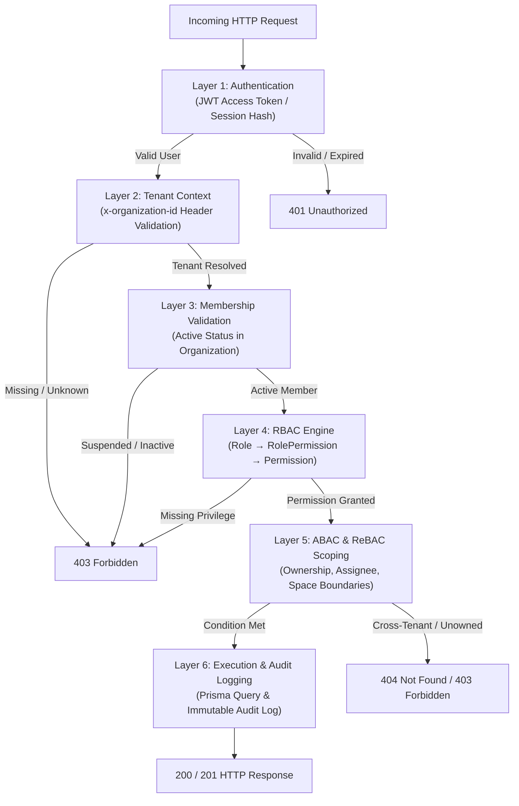
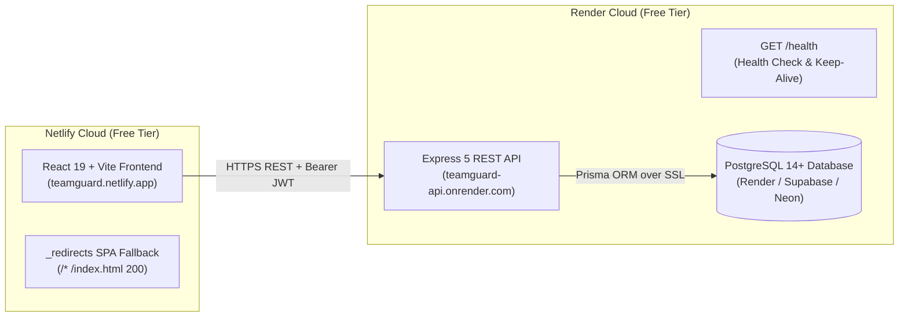

# TeamGuard — Product Requirements Document (PRD)

---

## 1. Executive Summary & Vision

**TeamGuard** is an enterprise-grade multi-tenant workspace, task orchestration, and authorization platform. It serves as both a high-performance productivity tool for distributed teams and a reference implementation of advanced **Role-Based Access Control (RBAC)**, **Attribute-Based Access Control (ABAC)**, **Relationship-Based Access Control (ReBAC)**, and **tamper-evident compliance audit logging**.

### Core Problem Solved
Traditional SaaS applications often conflate authentication with authorization, rely on coarse organization-wide roles (admin vs. member), or improperly trust client-side claims and static JWT tokens. TeamGuard addresses these vulnerabilities by establishing a **six-layer fail-closed authorization architecture** that verifies tenant boundary isolation, dynamic role permissions, and resource ownership attributes on every single backend request.

---

## 2. Target Personas & Privilege Profiles

| Persona | System Role | Primary Responsibilities & Permissions |
|---|---|---|
| **Platform Super Admin** | `Super Admin` | Global tenant lifecycle management, compliance oversight, break-glass security recovery, and system health monitoring. |
| **Organization Owner** | `Owner` | Full administrative control over an organization workspace: custom role creation, member invites/removals, billing/quotas, and space configuration. |
| **Project Manager** | `Manager` | Project and space management, task creation, workload rebalancing, and team velocity/compliance reporting. |
| **Team Member** | `Member` | Day-to-day task execution, subtask checklist completion, time tracking, and comments. Restricted to editing assigned tasks (`task:update:own`). |
| **Auditor / Viewer** | `Viewer` | Read-only oversight of projects, tasks, calendar schedules, and compliance audit records. Write operations are strictly denied (`403 Forbidden`). |
| **External Guest** | `Guest` | Scoped read access to explicitly shared projects and tasks with sensitive internal fields masked. |

---

## 3. The 6-Layer Authorization Framework

Every HTTP request entering the TeamGuard backend must traverse six sequential authorization stages:

1. **Authentication**: Resolves user identity via short-lived JWT (`15m`).
2. **Organization Context**: Parses and validates `x-organization-id` header.
3. **Membership Validation**: Fails closed if user lacks active membership in the target organization.
4. **RBAC (Role-Based)**: Aggregates permissions from all assigned tenant roles (`resource:action`).
5. **ABAC (Attribute-Based)**: Enforces row-level ownership rules (`task.assigneeId === user.id` vs. `task:update:any`).
6. **Compliance Audit Logging**: Automatically writes immutable audit records capturing actor, action, resource, outcome, and timestamp.

---

## 4. Canonical Role-Permission Matrix

| Permission String | Description | Owner | Admin | Manager | Member | Viewer | Guest |
|---|---|:---:|:---:|:---:|:---:|:---:|:---:|
| `project:read` | View space projects | ✅ | ✅ | ✅ | ✅ | ✅ | Scoped |
| `project:create` | Create workspace project | ✅ | ✅ | ✅ | ❌ | ❌ | ❌ |
| `project:update` | Edit project metadata | ✅ | ✅ | Scoped | ❌ | ❌ | ❌ |
| `project:delete` | Soft-delete / archive project | ✅ | ✅ | ❌ | ❌ | ❌ | ❌ |
| `task:read` | View tasks and subtasks | ✅ | ✅ | ✅ | ✅ | ✅ | Scoped |
| `task:create` | Create new tasks | ✅ | ✅ | ✅ | ✅ | ❌ | ❌ |
| `task:update:own` | Modify assigned tasks | ✅ | ✅ | ✅ | ✅ | ❌ | ❌ |
| `task:update:any` | Modify any task in project | ✅ | ✅ | ✅ | ❌ | ❌ | ❌ |
| `task:delete` | Delete task | ✅ | ✅ | Scoped | ❌ | ❌ | ❌ |
| `file:read` | View workspace file assets | ✅ | ✅ | ✅ | ✅ | ✅ | ❌ |
| `file:upload` | Upload new assets | ✅ | ✅ | ✅ | ✅ | ❌ | ❌ |
| `file:delete` | Delete file assets | ✅ | ✅ | ❌ | ❌ | ❌ | ❌ |
| `member:read` | View member directory | ✅ | ✅ | ✅ | ✅ | ✅ | ❌ |
| `member:manage` | Invite, remove, change roles | ✅ | ✅ | ❌ | ❌ | ❌ | ❌ |
| `role:read` | View role templates & matrix | ✅ | ✅ | ✅ | ❌ | ❌ | ❌ |
| `role:manage` | Create / edit custom roles | ✅ | ✅ | ❌ | ❌ | ❌ | ❌ |
| `audit:read` | Access security audit logs | ✅ | ✅ | ❌ | ❌ | ❌ | ❌ |
| `reports:read` | View analytics & export CSV | ✅ | ✅ | ✅ | ❌ | ❌ | ❌ |
| `org:delete` | Purge organization workspace | ✅ | ❌ | ❌ | ❌ | ❌ | ❌ |

---

## 5. Domain Functional Modules

### 5.1 ReBAC Space Hierarchy
- Hierarchical structure: `Organization → Space → Project → Task → Subtask`.
- Left-sidebar tree navigation displays active spaces with project counts and live summation badges of active work (`Todo + In-Progress`).
- Spaces support privacy levels (`PUBLIC`, `PRIVATE`, `INVITE_ONLY`) with inheritance for project permissions.

### 5.2 Dynamic Kanban Board
- Multi-lane Kanban columns: `TODO`, `IN_PROGRESS`, `IN_REVIEW`, `DONE`, `CANCELLED`.
- Drag-and-drop task reordering with optimistic UI updates.
- Column quick-add for fast issue creation without leaving the board view.
- Attribute-based security: `Member` persona can edit own tasks, while dragging unassigned tasks triggers a permission guard.

### 5.3 Interactive Calendar Module
- **Multi-View Modes**: Month, Week, Day, and Agenda views.
- **Date Cell Quick-Add**: Hovering on future date cells surfaces a `[+]` button to open the "Schedule Release Task" modal with prefilled target date.
- **Day Tasks Modal**: Clicking any date cell opens a modal displaying all tasks scheduled for that day, or an interactive empty-state encouraging task scheduling.
- **Past-Date Immutability**: Historical dates are rendered with subtle lock indicators; task creation, editing, and drag drops onto past dates are strictly prevented.
- **Color-Coded Status Pills**: Status and priority pills leverage high-contrast, opaque surfaces for maximum legibility.

### 5.4 Executive & Compliance Reports
- **Executive KPI Cards**: Total task counts, completion rate, overdue alerts, and active member counts.
- **30-Day Task Velocity Trend**: Daily planned vs. completed task trend visualization.
- **Team Workload Distribution**: Horizontal progress breakdown showing assigned workload and backlog distribution per team member.
- **Storage Quota & Utilization**: Visual representation of organization file usage against allocated quota.
- **One-Click CSV Compliance Exports**:
  - `Tasks Velocity & Status Report`: Exports filtered tasks with assignees, dates, and priorities.
  - `Security & Audit Compliance Report`: Exports timestamped audit trail records for SOC2 / ISO27001 readiness.

### 5.5 In-Memory Smart Query Caching
- **Client Cache**: 15-second in-memory query cache in `api-client.js` with LRU eviction (max 150 entries).
- **Conditional HTTP 304 Not Modified**: API responses return `ETag` hashes. Subsequent identical queries issue `If-None-Match` requests.
- **Smart Tenant Mutation Invalidation**: Any write operation (POST, PATCH, DELETE) automatically purges corresponding cache keys for the active organization.
- **Context-Switch Cache Purge**: Switching organizations immediately wipes all client query caches to prevent cross-tenant data leakage.

### 5.6 Accessible High-Opacity Theme System
- Dual theme support: High-Contrast Dark (`#0B0E14` base, `#141824` cards, `#283142` borders) and High-Contrast Light (`#F4F6F9` base, `#FFFFFF` cards, `#D3DCE6` borders).
- Eliminates low-contrast translucent overlays (`rgba`) in favor of solid surfaces with WCAG AAA compliant text contrast.

---

## 6. Technical & Deployment Architecture

### 6.1 Frontend Hosting (Netlify Free Tier)
- **Static Site Hosting**: Pre-rendered Vite bundle published to Netlify CDN.
- **SPA Routing Rule**: `frontend/public/_redirects` maps `/*` to `/index.html` with HTTP 200 to prevent 404s on browser reloads.
- **Security Headers**: `X-Frame-Options: DENY`, `X-Content-Type-Options: nosniff`, `Referrer-Policy: strict-origin-when-cross-origin`.
- **Environment**: Reads `VITE_API_URL` pointing to the Render backend service.

### 6.2 Backend Hosting (Render Free Tier)
- **Node.js Web Service**: Configured via `render.yaml` with zero-configuration Blueprint support.
- **Build Step**: `npm install && npx prisma generate`.
- **Start Step**: `npm start` (`node server.js`).
- **Health Check**: Native `GET /health` endpoint returning database connection status.
- **CORS & Cross-Origin Cookies**:
  - `FRONTEND_ORIGIN` whitelist permitting the Netlify app domain.
  - `COOKIE_SAME_SITE=none` and `COOKIE_SECURE=true` enabling cross-domain refresh token cookies between Netlify and Render.

### 6.3 Database Architecture (Supabase Managed PostgreSQL)
- **Engine**: Managed PostgreSQL 14+ on Supabase with SSL enforcement.
- **Connection Routing**:
  - Runtime queries utilize Supavisor Connection Pooler on port 6543 (`DATABASE_URL`).
  - Schema migrations and deployment utilize Direct Connection on port 5432 (`DIRECT_URL`).
- **Production Initialization Script (`init-production-db.js`)**:
  - Applies database schema migrations and relational constraints via `npx prisma migrate deploy`.
  - Seeds the canonical 36-permission RBAC catalogue.
  - Guarantees zero test/demo records (0 demo organizations, 0 sample projects, 0 mock tasks).

---

## 7. Security & Compliance Invariants

1. **Zero Client Trust**: All authorization logic executes server-side in Prisma transactions and middleware.
2. **Strict Tenant Boundaries**: Every Prisma query explicitly filters by `where: { organizationId }`.
3. **Session Lifecycle**: Refresh tokens stored as SHA-256 hashes; automatic family revocation upon detected token reuse.
4. **Audit Immutability**: All security-relevant events recorded in append-only `AuditLog` table.
5. **No Secret Leaks**: Passwords and tokens excluded from serialization and logs.

---

## 8. Success Metrics & Verification Criteria

- [x] 100% test coverage across RBAC and tenant boundary negative test suites.
- [x] Zero cross-tenant data leakage in multi-organization context switching.
- [x] Production build passes Vite minification and linting.
- [x] Single-command deployment on Netlify and Render free tiers.
